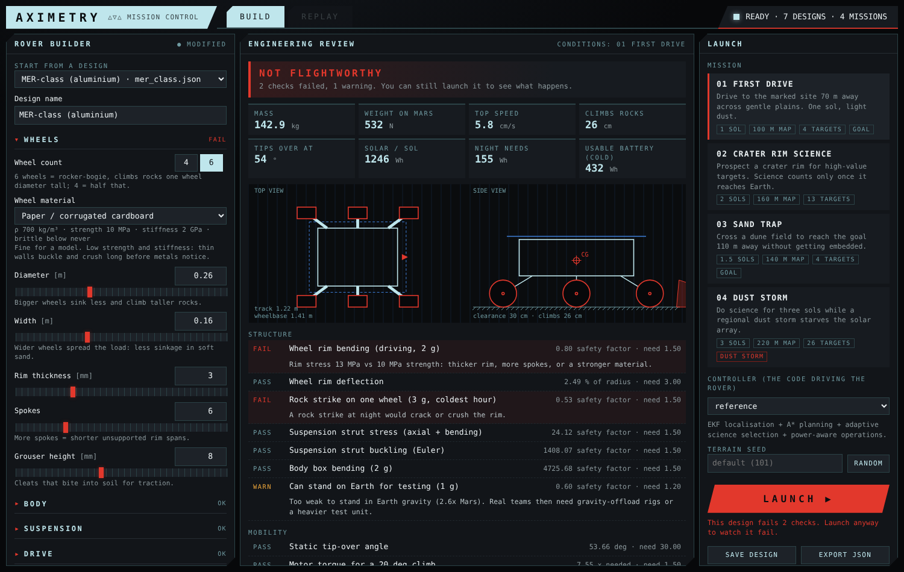
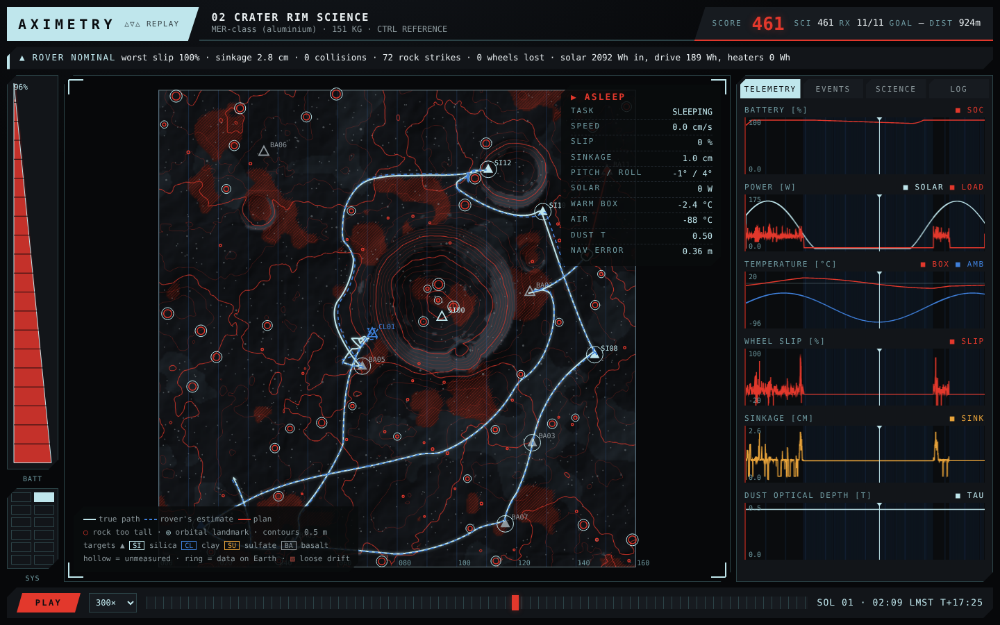
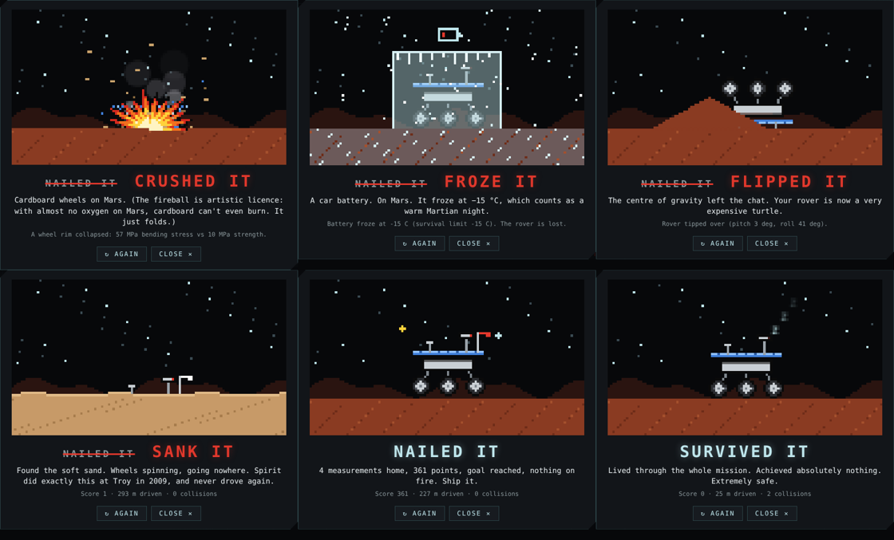
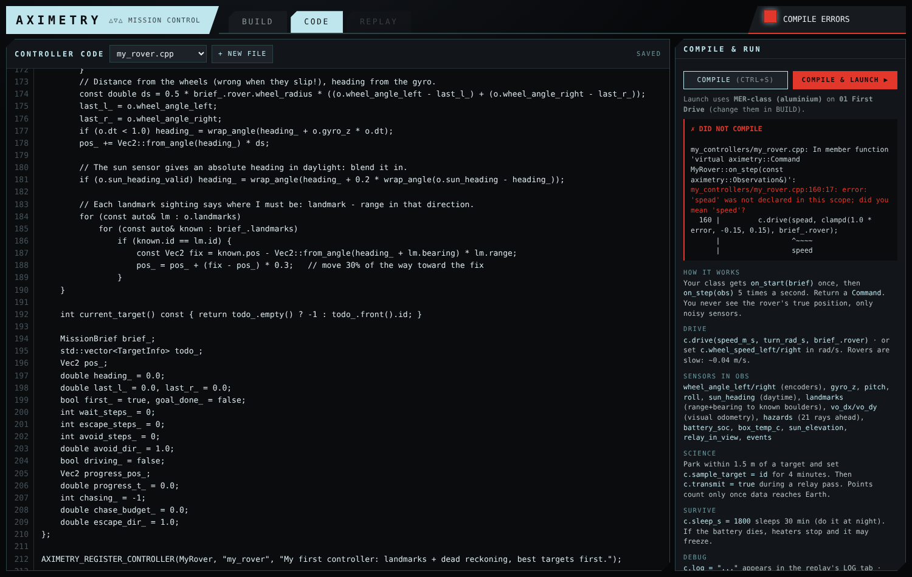
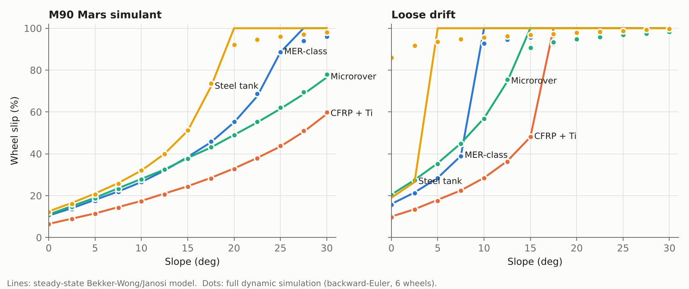

# AXIMETRY

**A Mars rover design and autonomy simulator, written from scratch in C++17.**

Pick your rover's materials, wheels, motors, battery and solar array. Aximetry
tells you whether it would survive Mars, then drops it onto procedurally
generated terrain where your own C++ code has to drive it, find science
targets, keep the battery warm through the night and get data home through a
relay orbiter, all from noisy sensors.





It is two things at once:

* **A teaching sandbox.** Build a rover out of cardboard, carbon steel or PLA and
  watch exactly *why* it fails: the rim bending stress, the brittle transition in
  the cold, the lead-acid battery that freezes after one brownout. Every failure
  comes with the physics and the real mission it echoes (Spirit stuck at Troy,
  Opportunity lost in the 2018 dust storm, Curiosity's damaged wheels).
* **A robotics testbed.** A full autonomy stack ships as the reference
  controller (EKF localisation, A\* planning, slip estimation, adaptive science
  selection, power-aware operations), with ablations and a benchmark harness so
  you can measure what each piece is worth.

No dependencies beyond a C++17 compiler and CMake. No ROS, no Gazebo, no GPU.

---

## What's inside

| Part | What it does |
|---|---|
| **Terramechanics** | Bekker pressure–sinkage, compaction resistance, Janosi–Hanamoto shear thrust, slip sinkage, per wheel, on five soil types (two from published Mars-simulant measurements) |
| **Vehicle dynamics** | 4- or 6-wheel skid-steer rover with weight transfer, tip-over, DC motor torque–speed curves, solved with backward Euler + Newton for stiff slip dynamics |
| **Structures** | Mass from material density; rim bending, rim stiffness, strut buckling (Euler), body bending, rock-strike fatigue (Miner), cold embrittlement |
| **Environment** | Sun position from latitude and season, dust optical depth, dust storms, diurnal temperature, panel dust |
| **Power & thermal** | Solar array, battery chemistries with cold derating, warm-electronics box with heaters and RHUs, brownouts and freezing |
| **Comms & science** | Relay passes, data storage, one-way light time, uplinked priority changes; targets whose mineralogy orbit sometimes gets wrong |
| **Sensors** | Wheel encoders, biased gyro, accelerometer, sun sensor, landmark camera, visual odometry, hazard scanner |
| **Reference autonomy** | EKF + VO slip estimation + two-landmark relocalisation, traversability cost map + A\*, pure pursuit, stuck recovery, value-per-hour target selection that learns how far to trust orbit, storm detection, sleep/wake planning around relay passes |
| **Mission control GUI** | Pick every part in the browser, watch structural, mobility, power and thermal checks update live on a schematic, choose a mission and controller, launch, and watch the replay |
| **Tooling** | Design review (`check`), design comparison, mission runs with an HTML replay viewer, slip-vs-slope experiments, multi-seed benchmarks, 140-check test suite |

Details: [docs/physics.md](docs/physics.md) · [docs/writing_a_controller.md](docs/writing_a_controller.md) · [docs/validation.md](docs/validation.md)

---

## Build and run

You need **CMake ≥ 3.16** and a **C++17 compiler** (GCC 9+, Clang 10+, MinGW-w64, or Visual Studio 2019+).

```bash
cmake -S . -B build -DCMAKE_BUILD_TYPE=Release
cmake --build build -j
```

Where the program ends up depends on your compiler:

| setup | program |
|---|---|
| macOS / Linux | `./build/aximetry` |
| Windows with MinGW (GCC) | `.\build\aximetry.exe` |
| Windows with Visual Studio | `.\build\Release\aximetry.exe` |

### Open mission control

Run the program with no arguments, or **double-click `aximetry.exe`** on Windows:

```bash
./build/aximetry
```

A small window opens (keep it open; it is the simulator) and your browser shows
mission control at `http://127.0.0.1:8080`:

1. **Build.** Start from any design and change anything: wheel count, size and
   material, body, suspension struts, motors, battery chemistry and size, solar
   array, heaters, insulation, payload. The engineering review updates as you
   type: mass budget, safety factors, tip-over angle, how each soil type treats
   your wheels, energy per sol, and a schematic with failing parts in red.
2. **Launch.** Pick a mission (the review switches to that mission's climate),
   pick a controller and optionally a terrain seed, and launch. Failing designs
   can still be launched, to watch them fail.
3. **Replay.** It opens with a little pixel-art cutscene of how it went:
   *NAILED IT*, or a glitch-cut to *CRUSHED IT*, *FROZE IT*, *FLIPPED IT* or
   *SANK IT*, with a one-line explanation of the physics that did it. Then watch
   the run itself: true path vs the rover's own estimate, live telemetry, events,
   science results and the controller's log. Drag the timeline, scroll to zoom,
   space to play.



### Run your own code

Open the **CODE** tab. It holds a working starter controller
(`my_controllers/my_rover.cpp`) that you can edit right there:

* **Compile** (Ctrl+S) builds just your file in a couple of seconds and shows
  compiler errors with the line highlighted.
* **Compile & launch** runs it on the rover and mission chosen in BUILD.
* **+ New file** starts another controller. Every file in `my_controllers/`
  shows up in the Launch panel's controller list.
* The side panel is a cheat sheet of every sensor and command. An endless loop
  in your code is stopped after 3 minutes instead of freezing the app.

Compiling from the GUI needs GCC or Clang (MinGW on Windows works). With Visual
Studio, copy your file into `controllers/` and rebuild instead.



**Save design** writes your rover to `rovers/custom_<name>.json`, and it shows up
in the preset list next time.

The server only listens on your own computer (`127.0.0.1`), not the network.

### Command line

Everything in the GUI is also scriptable (on Windows, use the program path from the table above):

```bash
./build/aximetry check rovers/paper_rover.json          # engineering review in the terminal
./build/aximetry compare rovers/*.json                  # every design side by side
./build/aximetry run --rover rovers/mer_class.json --mission missions/02_crater_science.json \
                     --controller reference --html crater.html
./build/aximetry catalog                                # materials, motors, batteries, soils
./build/aximetry_tests                                  # test suite
./build/aximetry help
```

### Missions

| Mission | Sols | The challenge |
|---|---|---|
| `01_first_drive` | 1 | Drive 70 m to a goal across gentle plains. Watch dead reckoning drift. |
| `02_crater_science` | 2 | Prospect a crater rim. Orbit mislabels a third of the targets. Science counts only once it reaches Earth; a priority change is uplinked on sol 2. |
| `03_sand_trap` | 1.5 | Cross a dune field to a goal 110 m away without getting embedded (Spirit, Troy, 2009). |
| `04_dust_storm` | 3 | Keep doing science while a regional storm (τ = 5.5) starves the solar array (Opportunity, 2018). |

### Rover designs

`mer_class` (Spirit/Opportunity-sized aluminium) · `cfrp_titanium` (lightweight modern) ·
`mini_sojourner` (11 kg microrover) · `steel_tank` (heavy carbon steel) ·
`paper_rover` (cardboard) · `pla_printed` (3D-printed hobby rover) · `lead_acid_budget` (car battery, no RHUs).

Make your own by copying one. Rover files are commented JSON:

```jsonc
"wheels": { "count": 6, "diameter_m": 0.26, "width_m": 0.16, "rim_thickness_mm": 3.0,
            "grouser_height_mm": 8, "spokes": 6, "material": "al7075" },
"power":  { "battery": "li_ion", "battery_wh": 600, "solar_area_m2": 1.3 },
```

---

## Write your own controller (without the GUI)

```cpp
#include "aximetry/controller.hpp"
using namespace aximetry;

class MyRover : public Controller {
public:
    void on_start(const MissionBrief& b) override { rover_ = b.rover; }
    Command on_step(const Observation& o) override {
        Command c;
        if (o.sun_elevation < 0) { c.sleep_s = 1800; return c; }
        c.drive(0.03, 0.0, rover_);          // 3 cm/s straight ahead
        c.transmit = o.relay_in_view;
        return c;
    }
private:
    RoverInfo rover_;
};
AXIMETRY_REGISTER_CONTROLLER(MyRover, "my_rover", "My first controller");
```

Drop it in `controllers/`, rebuild, and it appears in the GUI's controller list (or use `--controller my_rover`).
[`controllers/template_controller.cpp`](controllers/template_controller.cpp) is a starting point;
[docs/writing_a_controller.md](docs/writing_a_controller.md) explains every sensor and command.

Benchmark it against the reference over many random terrains:

```bash
./build/aximetry experiment bench --rover rovers/mer_class.json \
    --mission missions/02_crater_science.json --controllers reference,my_rover --seeds 10 --out bench.csv
```

---

## Results

**The dynamics agree with the analytic model.** Steady-state slip predicted by
the Bekker–Wong/Janosi model (lines) against the full six-wheel dynamic
simulation driving up a constant slope (dots):



Wider, lighter wheels (CFRP + Ti) climb further; the steel tank sinks and stalls
early; every design bogs down on sloped loose drift, which is what stopped Spirit.
On the steel tank in drift the dynamic run settles at high slip even on flat
ground while the steady-state model finds a low-slip solution: starting from rest
the wheels dig in first, and the force balance has two equilibria.

**What each autonomy component is worth.** Mean mission score over random
terrains, with one capability switched off at a time:

| Controller | 02 Crater (8 seeds) | 04 Dust storm (4 seeds) | targets on Earth (crater) | metres driven (crater) |
|---|---|---|---|---|
| Full stack | 436 ± 94 | 1128 ± 179 | 10.4 | 656 |
| No value ranking (nearest first) | 454 ± 70 | 1113 ± 232 | 10.6 | 537 |
| No visual-odometry slip estimate | 455 ± 69 | 1114 ± 249 | 10.6 | 651 |
| No landmark updates | 92 ± 89 | 110 ± 69 | 1.8 | 1025 |
| Dead reckoning only | 0 ± 0 | 0 ± 0 | 0.0 | 61 |

Landmark-based localisation is the component that matters most: without it the
rover drives further but cannot get within instrument range of targets. Value
ranking and VO slip estimation make no measurable difference on these missions
(differences are within one standard deviation); [docs/validation.md](docs/validation.md)
discusses why and how to design missions that would separate them. Full numbers are in [`results/`](results/).

Regenerate everything:

```bash
for r in mer_class cfrp_titanium mini_sojourner steel_tank; do
  for s in m90_simulant loose_drift; do
    ./build/aximetry experiment slip-slope --rover rovers/$r.json --soil $s --out results/slip_${r}_${s}.csv
  done
done
python3 tools/plot_results.py      # needs matplotlib
```

---

## Project layout

```
include/aximetry/   public headers (controller.hpp is the API you code against)
src/                simulator: terramechanics, terrain, rover, environment, sim, design check, GUI server, CLI
controllers/        controllers, auto-compiled (reference/ = the full autonomy stack)
rovers/             rover designs (commented JSON)
missions/           missions (commented JSON)
tests/              test suite
tools/gui.html      mission-control GUI (served by `aximetry gui`)
my_controllers/     your controllers from the GUI's CODE tab (compiled on demand)
tools/viewer.html   replay viewer (the GUI and CLI embed runs into it)
tools/plot_results.py
docs/               physics, controller guide, validation, figures
results/            experiment outputs
```

## Limitations

Aximetry is a planar (2.5D) model built for mobility sizing and autonomy
experiments, not a 3D multibody simulator: no suspension articulation, no
lateral side-slip on slopes, no rut memory in the soil, a single thermal node,
measurement-model sensors rather than rendered images, and three of the five
soils use illustrative parameters. See [docs/physics.md §9](docs/physics.md#9-known-limitations).

## Ideas for extending it

* A learned controller (RL on the same API) benchmarked against the reference.
* Particle-filter or graph-SLAM localisation, mapping uncatalogued rocks as landmarks.
* D\* Lite incremental replanning; energy-optimal routing with the terramechanics model as the cost.
* Rocker-bogie kinematics and 3D contact for climbing.
* Ocean-world variant: an under-ice vehicle tracing a hydrothermal plume.

## References

* M. G. Bekker, *Introduction to Terrain-Vehicle Systems*, University of Michigan Press, 1969.
* J. Y. Wong, *Theory of Ground Vehicles*, Wiley.
* Z. Janosi and B. Hanamoto, "The analytical determination of drawbar pull as a function of slip for tracked vehicles in deformable soils", 1961.
* M90 and dry-sand Bekker–Wong parameters as compiled in arXiv:2606.06790, Table 2.
* J. Appelbaum and D. J. Flood, *Solar radiation on Mars*, NASA TM-102299, 1990.
* M. Maimone, Y. Cheng and L. Matthies, "Two years of visual odometry on the Mars Exploration Rovers", *Journal of Field Robotics*, 2007.
* NASA/JPL rover wheel specifications (Sojourner, MER, MSL, Mars 2020) from JPL's Curiosity wheel-wear documentation.

## License

MIT — see [LICENSE](LICENSE).
