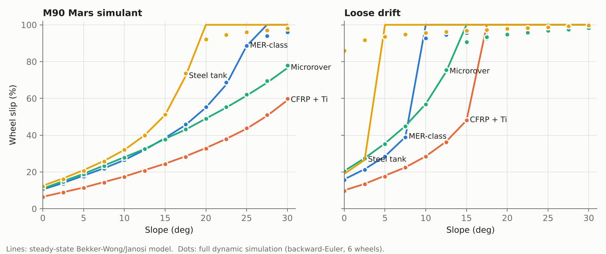
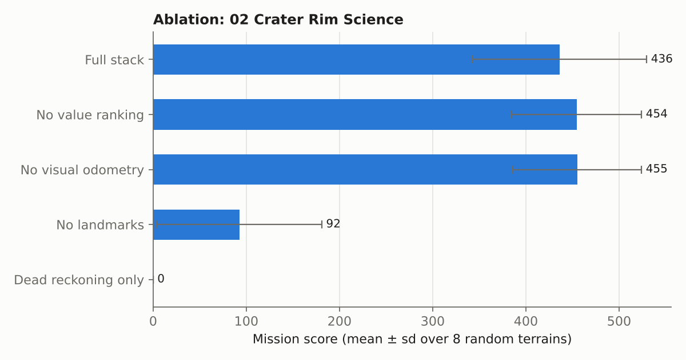
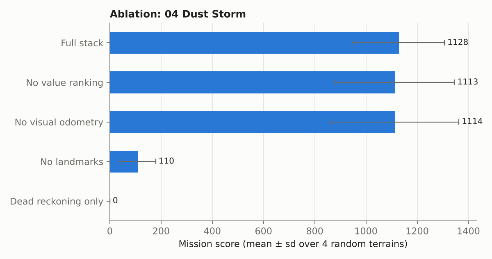

# Validation and experiments

What is checked, how, and what the numbers say. All of it is reproducible with
the commands in the README; the test suite (`./build/aximetry_tests`) runs the
automated checks.

## 1. Closed-form checks (automated)

| check | how |
|---|---|
| Bekker static sinkage | simulator value equals the closed-form expression to 1e-12 |
| Sinkage trends | heavier → deeper, wider wheel → shallower, weak soil → deeper |
| Janosi thrust | zero at zero slip, strictly increasing, bounded by Hmax, odd in slip, small-slip series continuous with exact branch |
| Environment | no sun at midnight, > 300 W/m² at noon, storm cuts noon irradiance by > 60 %, afternoon warmer than pre-dawn |
| Steady-state slip | increases monotonically with slope |
| Parked rover | holds still on a 12° slope for 11 hours of simulated time |
| Tip-over | declared on a slope 3° beyond the static tip angle |
| Determinism | same seed → identical score and distance |
| EKF | converges from a 2.5 m / 11° initial error onto three landmarks to < 0.15 m |
| A\* | routes around a wall without cutting corners; returns no path when the goal is enclosed |

## 2. Dynamics vs. the steady-state model

The design review computes slip analytically (find the slip at which
H(s) − Rc(s) balances the downslope load). The simulator instead integrates the
coupled six-wheel dynamics. Driving a constant wheel speed up a planar incline
and measuring slip from true ground speed in the second half of the run:

On M90 simulant the two agree to within about one percentage point of slip
until the wheels saturate (the 10° case is a unit test: 0.265 vs 0.265). Where
they disagree is informative: on loose drift, heavy rovers starting from rest
settle on a high-slip equilibrium even on flat ground. Starting from rest the
wheels are at full slip, slip sinkage digs them in, and the force balance has a
second, stuck solution. The steady-state analysis cannot see path dependence.

Qualitative behaviour of the MER-class design (151 kg, 26 cm wheels):

* climbs about 21° on the M90 simulant at ≤ 60 % slip;
* handles flat loose drift at ~16 % slip but cannot hold 10° of sloped drift,
  which is the Troy failure mode;
* sinks about 1 cm on firm simulant and 1.5–3 cm on drift.

These are plausibility checks, not quantitative validation against flight data.
Comparing them with published MER/MSL mobility test results would be the
natural next step.

## 3. Autonomy ablations

The reference controller with one capability removed at a time, MER-class rover,
different random terrain per seed (same mission rules):

| Controller | 02 Crater (8 seeds) | 04 Dust storm (4 seeds) | targets on Earth (crater) | metres driven (crater) |
|---|---|---|---|---|
| Full stack | 436 ± 94 | 1128 ± 179 | 10.4 | 656 |
| No value ranking (nearest first) | 454 ± 70 | 1113 ± 232 | 10.6 | 537 |
| No visual-odometry slip estimate | 455 ± 69 | 1114 ± 249 | 10.6 | 651 |
| No landmark updates | 92 ± 89 | 110 ± 69 | 1.8 | 1025 |
| Dead reckoning only | 0 ± 0 | 0 ± 0 | 0.0 | 61 |

Observations:

* **Landmarks matter most.** Without them the rover still drives (often further)
  but cannot get within the spectrometer's 1.5 m of targets: odometry plus visual
  odometry drift by metres over a few hundred metres of driving.
* **Value ranking and VO slip estimation show no measurable benefit on these
  missions.** Their scores sit within one standard deviation of the full stack
  (slightly above on the crater, slightly below in the storm). Two honest reasons:
  missions 02 and 04 give enough time to visit almost every target anyway, so the
  order matters little; and landmark corrections already absorb most slip error on
  mostly firm ground, while VO fails most often on sand, exactly where slip is
  worst. Designing missions where time is genuinely scarce, and testing on
  sand-dominated maps, is the obvious way to separate them.
* **Dead reckoning only** scores near zero: it never localises well enough to
  sample, which is the point of the comparison.

## 4. Known gaps

* No comparison against measured rover traverses (slip logs, power telemetry).
* Soil parameters for drift, crust and bedrock are illustrative.
* Variance is large with few seeds; treat differences of less than one
  standard deviation as noise.
